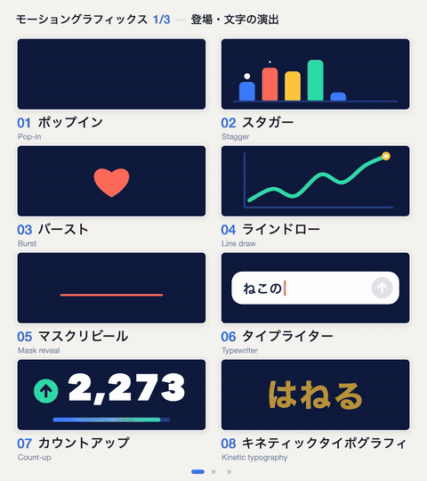

# Motion Prompt

[English](README.md) | **日本語**

AIに何かを作ってもらうときに使う「名前」のライブラリです。名前の1つずつに、動く見本・一言の意味・AIへの頼み方の例が付いています。いま入っているのは、モーショングラフィックスの動き24個（`motion`）と、カメラワーク24個（`camera`）の2つです。同じような名前の見本を、自分の分野・自分の言語で作るためのプロンプトも入っています。

| モーショングラフィックス | カメラワーク |
|---|---|
|  |  |

- ギャラリー（全部の見本が動きます）: https://showheyohtaki.github.io/motion-prompt/
- GitHub の上でそのまま読める名前の一覧: [`packs/`](packs/README.md)

## なぜ作ったか

モーショングラフィックスやカメラワークの「名前」を並べた短い動画を投稿したら、この数日、いろんなコメントをもらいました。その中に、自分を悩ませていたのは想像力の欠如ではなく、こういう動かし方を何と呼ぶのか分からないことだった、という趣旨のコメントがありました。

それを見て、いろんな言語で、各ジャンルの専門家の人たちが、AIを使いこなす上で必要な「共通言語」を、ライブラリにして見せてくれるんだったら、めちゃくちゃ役に立つと思いました。だから、それを GitHub にしてみました。

1個のスタイルを配るリポジトリではありません。ここのプロンプトと指示を使えば、こういうモーショングラフィックスを作れますし、自分の分野・自分の言語・自分の好きな見た目で、同じような名前の見本も作れます。そういう場所にしたいと思っています。

もう1つ、こんなコメントももらいました。"this is how you become a creative director"。まさに、です。世界中に、AIと共にすばらしい才能を発揮するクリエイティブディレクターが増えたら、素敵なことだと思います。

大滝昇平

## いま入っている名前

| 番号 | パック | 個数 | 一覧 |
|---|---|---|---|
| 001–024 | `motion`: モーショングラフィックスの動き | 24 | [日本語](packs/motion/README.ja.md) · [English](packs/motion/README.md) |
| 025–048 | `camera`: カメラワークと切り替え | 24 | [日本語](packs/camera/README.ja.md) · [English](packs/camera/README.md) |

一覧には、番号・名前・英語名・一言の意味・AIへの頼み方の例が並んでいます。同じ名前が[ギャラリー](https://showheyohtaki.github.io/motion-prompt/)で動きます。

2つのパックは見た目が違います。カメラワークは薄いグレーに青1色、モーショングラフィックスは濃紺に4色です。わざとそうしています。パックがそろえるべきなのは名前であって、決まった見た目ではありません。

## 3つの使い方

### 1. 名前を調べて、そのままAIに頼む

[一覧](packs/README.md)かギャラリーを開き、頭の中にある動きを探して、その名前を指示に入れます。「何秒で」「どのくらい強く」「何が動くか」を添えると、思った通りに近づきます。

```text
タイトルをマスクリビールで下からせり上げて。0.6秒、行ごとに少しずらして。
```

```text
人物の顔へゆっくりドリーイン。ズームではなく、カメラごと近づく。
```

これだけなら、何も入れる必要はありません。名前は、コーディングAIにも、動画生成AIにも、人への依頼にも使えます。

### 2. スキルを入れて、番号で頼む

Claude Code や Codex に `motion-prompt` スキルを入れると、AI が番号から仕様と参考コードを取り出し、あなたの動画の作り方に合わせて組み込みます。

```sh
npx skills add showheyohtaki/motion-prompt
```

```text
motion-prompt スキルで #012 と #045 を使って、このサービス紹介の動画をプロっぽく作ってください。
```

```text
今のタイトルが出る部分を、motion-prompt の #005 の演出に差し替えてください。尺と前後のつながりはそのままで。
```

```text
motion-prompt の #032 のカメラワークを、Veo に渡す英語のプロンプトにしてください。被写体は机の上のコーヒーカップです。
```

ほかの入れ方と、AI が何をするかは、下の[スキルの説明](#スキルの説明)にあります。

### 3. 自分の分野・自分の言語の版を作る

[`make-your-own/`](make-your-own/README.ja.md) に、コーディングAIに貼るプロンプト、動画を書き出すスクリプト、完成した見本2つ（HTMLのソース・動画3本・早見表の画像）が入っています。

| やりたいこと | プロンプト |
|---|---|
| 同じ動画を別の言語で作る | [`01-translate.md`](make-your-own/prompts/ja/01-translate.md) |
| 自分の分野の名前を、自分の好きな見た目で作る | [`02-your-own-field.md`](make-your-own/prompts/ja/02-your-own-field.md) |
| 1枚の早見表の画像を作る | [`03-cheatsheet-image.md`](make-your-own/prompts/ja/03-cheatsheet-image.md) |

映像でなくてもかまいません。照明、音、UI、写真、料理、建築など、名前を知っていることが頼めることにつながる分野なら、どこでも作れます。

## あなたの分野の名前を足す

よく知っている分野があれば、その分野の共通言語を、あなたの言語でここに足してください。パックの足し方、今あるパックへの言語の足し方、名前を入れるときの基準は [CONTRIBUTING.ja.md](CONTRIBUTING.ja.md) に書いてあります。作る作業の大半は、上のプロンプトでコーディングAIに任せられます。

## 元のポスト

きっかけになった動画（X）:

- https://x.com/showheyohtaki/status/2108065874511077598
- https://x.com/showheyohtaki/status/2109112248832503895
- https://x.com/showheyohtaki/status/2109840044554891464

1本目（Webサイト・LPのアニメーションの名前）のセットは、このリポジトリにはまだ入っていません。入っているのは、カメラワークとモーショングラフィックスの2つです。

## スキルの説明

Node.js 18 以上が必要です。

### 入れ方

**プロンプトで入れる。** Claude Code や Codex に、次の文を貼ります。

```text
https://github.com/showheyohtaki/motion-prompt を読んで、motion-prompt スキルをこの環境に入れてください。入れたら、使い方を3行で教えてください。
```

**コマンドで入れる。** Agent Skills に対応したエージェント（Claude Code、Codex など）で使えます。

```sh
npx skills add showheyohtaki/motion-prompt
```

**Claude Code のプラグインとして入れる。**

```text
/plugin marketplace add showheyohtaki/motion-prompt
/plugin install motion-prompt@motion-prompt
```

**手でコピーする。** `skills/motion-prompt` フォルダを、次のどれかにコピーします。

| 置き場所 | 対象 |
|---|---|
| `~/.claude/skills/` | Claude Code（全プロジェクト） |
| `~/.agents/skills/` | Codex など（全プロジェクト） |
| プロジェクトの `.claude/skills/` | Claude Code（そのプロジェクトだけ） |
| プロジェクトの `.agents/skills/` | Codex など（そのプロジェクトだけ） |

### エージェント向けの導入手順

この節は、上の「プロンプトで入れる」の文を受け取った AI エージェントが読む手順です。

1. `node --version` で Node.js 18 以上が使えることを確かめます。
2. 利用者のプロジェクトのフォルダで、次を実行します。どのエージェントに入れるか聞かれたら、いま動いている自分自身を選びます。
   ```sh
   npx skills add showheyohtaki/motion-prompt -y
   ```
3. 2 が使えない場合は、リポジトリを取得してフォルダをコピーします。コピー先は、自分が Claude Code なら `.claude/skills/`、それ以外なら `.agents/skills/` です（全プロジェクトで使うなら `~/.claude/skills/` または `~/.agents/skills/`）。
   ```sh
   git clone --depth 1 https://github.com/showheyohtaki/motion-prompt.git /tmp/motion-prompt
   mkdir -p .claude/skills
   cp -R /tmp/motion-prompt/skills/motion-prompt .claude/skills/
   ```
4. 入ったことを確かめます。`<skill-dir>` は `SKILL.md` があるフォルダです。取得元と要素の件数が表示されれば成功です。
   ```sh
   node <skill-dir>/scripts/motion-prompt.mjs info
   ```
   終了コード 3 は、データの取得元に届いていないという意味です。ネットワークの許可を得てもう一度実行してください。
5. `<skill-dir>/SKILL.md` を読み、利用者に使い方を 3 行で伝えます。例:
   - 「motion-prompt スキルで #012 と #045 を使って」のように、番号で頼めます。
   - 番号が決まっていなければ、場面を伝えると候補を探します。
   - 番号と見本は https://showheyohtaki.github.io/motion-prompt/ で確認できます。

既存の設定ファイルやほかのスキルは変更しないでください。

### AI がすること

AI は次の順に進めます。

1. プロジェクトの動画の作り方（Canvas、Remotion、CSS、After Effects、動画生成 AI へのプロンプトなど）を読みます。
2. 頼まれた内容を場面ごとの動きに分けます。
3. 番号の指定があればその要素を、無ければ場面ごとに検索して選んだ要素を取得します。
4. 時間・イージング・量の数値を保ったまま、プロジェクトの方式に移します。文字・色・素材はあなたの物に替えます。
5. 使った要素を、番号・使った場所・変えた点・見本の URL 付きで報告します。

### 仕組み

- 要素は 1 個が 1 つの関数です。`cells[i](ctx, w, h, u)` の形で、`ctx` は Canvas 2D のコンテキスト、`w` と `h` はカードの寸法、`u` は周期の中の秒数です。
- 関数は時刻 `u` だけで絵が決まります（現在時刻や乱数を描画時に使いません）。そのため、ブラウザでの再生と 1 フレームずつの書き出しで同じ絵になります。
- 色・寸法・周期・共通の補助関数は、パックごとの「kit」にまとまっています。要素を使うときは、そのパックの kit も一緒に読み込みます。
- 外部ライブラリは使っていません。

スキルの中身は、`SKILL.md`、移植の手引き（`references/porting.md`）、依存なしの小さな CLI（`scripts/motion-prompt.mjs`）です。

| コマンド | 内容 |
|---|---|
| `search typewriter text` / `search 文字 登場` | 場面に合う要素を探す（英語・日本語） |
| `list` / `list --pack motion` | パックとカテゴリの一覧、または 1 パックの全要素 |
| `get 12 #045` | 選んだ要素の仕様とコード（1 回に 8 個まで） |
| `kit motion` | そのパックの共通コード |
| `prompt 12` | その要素のコピー用プロンプト |
| `info` | 取得元・件数・版・キャッシュの場所 |

データは静的ファイルで、次の場所から読みます。CLI はこれらを取得するだけで、あなたのプロジェクトの情報を送信しません。

1. `https://showheyohtaki.github.io/motion-prompt/api/v1/`
2. 1 に届かないとき: `https://raw.githubusercontent.com/showheyohtaki/motion-prompt/main/api/v1/`

| ファイル | 内容 |
|---|---|
| `catalog.json` | 版、件数、パック、全要素の名前・一言の意味・要約・仕様・タグ |
| `{ja,en}/catalog.tsv` | 1 行 1 要素の一覧（id、pack、category、title、tags、summary） |
| `{ja,en}/e/{id}.txt` | 要素 1 個: ライセンス行、説明、仕様、コード |
| `{ja,en}/p/{id}.txt` | 要素 1 個のコピー用プロンプト |
| `kit/{pack}.js` | パックの共通コード |

このリポジトリを丸ごと clone して使う場合、CLI は手元の `api/v1` を優先して読むので、ネットワークは不要です。取得したデータはディスクに保存され、取得元に届かないときは保存済みの分を使います。

| 環境変数 | 既定 |
|---|---|
| `MOTION_PROMPT_BASE` | 取得元の差し替え（フォルダか URL。カンマ区切りで複数） |
| `MOTION_PROMPT_CACHE` | `~/.cache/motion-prompt`（書けなければ一時フォルダ） |
| `MOTION_PROMPT_TTL` | `21600`（カタログを取り直すまでの秒数） |

### ギャラリーを手元で動かす

```sh
git clone https://github.com/showheyohtaki/motion-prompt.git
cd motion-prompt
python3 -m http.server 8000
```

ブラウザで `http://localhost:8000/` を開くと、ギャラリー（`index.html`）が表示されます。ファイルの形式は [FORMAT.md](FORMAT.md) に書いてあります。

## ライセンス

[MIT](LICENSE) © 2026 Shohei Ohtaki

コード・動画・画像とも、商用の制作に使えます。要素のコードを使うときは、先頭の 1 行（`// Motion Prompt #ID · MIT License (c) 2026 Shohei Ohtaki · …`）を残してください。

## 謝辞

動く UI のギャラリーとエージェントスキルを組み合わせた [Lucian UX/UI Prompt](https://lucianlabs.dev/uxui-prompt/) から着想を得ました。CLI のコマンド構成と静的ファイルの置き方も同プロジェクトに倣っています（[THIRD-PARTY-NOTICES.md](THIRD-PARTY-NOTICES.md)）。

## 作者

大滝昇平（株式会社デイトラ） / X [@showheyohtaki](https://x.com/showheyohtaki)
