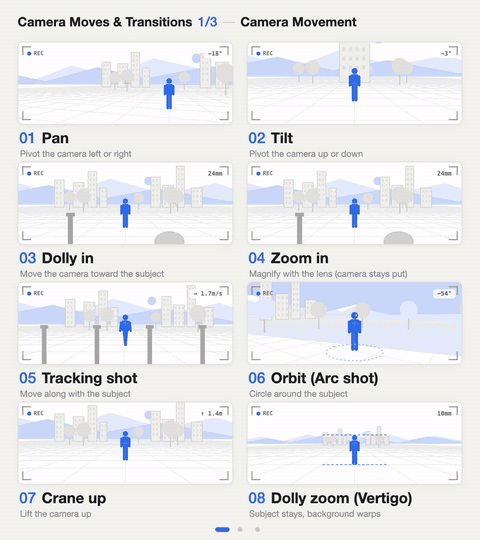

<!-- 此文件由 tools/build.mjs 根据 meta.json 生成。如需修改，请编辑 meta.json，不要直接修改此文件。 -->

# 摄影机运动与转场

24 个名称 · #025–048 · 类别包 `camera` · 语言: [English](README.md) / [日本語](README.ja.md) / [繁體中文](README.zh-Hant.md)

找到名称后，直接告诉 AI。再补充“几秒”“强度”和“什么在动”，结果会更接近你的想法。

## 镜头运动

| 编号 | 名称 | 英文名称 | 效果说明 | 给 AI 的示例说法 |
|---|---|---|---|---|
| [#025](https://budingsm.github.io/motion-prompt-zh/#025) | **横摇** | Pan | 摄影机原地左右转动 | 摄影机位置固定，由左往右慢慢横摇，扫过整片街景，整段花 5 秒。 |
| [#026](https://budingsm.github.io/motion-prompt-zh/#026) | **直摇** | Tilt | 摄影机原地上下转动 | 摄影机原地不动，从人物的脚部慢慢往上直摇，一路摇到塔顶。 |
| [#027](https://budingsm.github.io/motion-prompt-zh/#027) | **Dolly in** | Dolly in | 摄影机本身朝被摄体前进 | 用 Dolly in 让摄影机慢慢朝她的脸前进。要实际移动摄影机，不要用变焦。 |
| [#028](https://budingsm.github.io/motion-prompt-zh/#028) | **Zoom in** | Zoom in | 摄影机不动，只用镜头放大 | 摄影机不动，用 3 秒对窗边的人物做 Zoom in。 |
| [#029](https://budingsm.github.io/motion-prompt-zh/#029) | **跟拍** | Tracking shot | 摄影机跟著被摄体一起移动 | 摄影机从正侧面跟拍走路的人物，以相同速度与他并排移动。 |
| [#030](https://budingsm.github.io/motion-prompt-zh/#030) | **环绕运镜** | Orbit (Arc shot) | 摄影机绕著被摄体转 | 用环绕运镜让摄影机绕著站立的人物走半圈，人物始终保持在画面中央。 |
| [#031](https://budingsm.github.io/motion-prompt-zh/#031) | **升镜** | Crane up | 摄影机往上升起 | 摄影机从人物的视线高度垂直往上升镜，一路升到整个小镇都入镜为止。 |
| [#032](https://budingsm.github.io/motion-prompt-zh/#032) | **希区考克变焦** | Dolly zoom (Vertigo) | 主体大小不变，背景被拉扯变形 | 在他意识到的瞬间，对他的脸用希区考克变焦：人物大小维持不变，只有背景往后拉远。 |

## 拍摄手法与时间效果

| 编号 | 名称 | 英文名称 | 效果说明 | 给 AI 的示例说法 |
|---|---|---|---|---|
| [#033](https://budingsm.github.io/motion-prompt-zh/#033) | **焦点转移** | Rack focus | 焦点在前景与后景之间转移 | 用 1 秒做焦点转移，把对焦点从前景的杯子移到后方的人物。 |
| [#034](https://budingsm.github.io/motion-prompt-zh/#034) | **手持** | Handheld | 像用手拿著拍的轻微晃动 | 用手持摄影从后方跟著走路的人物拍摄，晃动要轻微。 |
| [#035](https://budingsm.github.io/motion-prompt-zh/#035) | **FPV 穿越机** | FPV drone shot | 高速、身历其境的穿梭飞行 | 用 FPV 穿越机镜头在树林间高速穿梭，再飞出树林、来到河面上方。 |
| [#036](https://budingsm.github.io/motion-prompt-zh/#036) | **荷兰角** | Dutch angle | 让画面沿镜头轴向歪斜一边 | 这场戏气氛不安，请用荷兰角，让画面歪斜约 15 度。 |
| [#037](https://budingsm.github.io/motion-prompt-zh/#037) | **慢动作** | Slow motion | 把动作放慢播放 | 用慢动作呈现水花溅起的瞬间。 |
| [#038](https://budingsm.github.io/motion-prompt-zh/#038) | **速度渐变** | Speed ramp | 同一个镜头中途改变速度 | 速度渐变：跳跃前后维持正常速度，只在跳到最高点时平顺放慢。 |
| [#039](https://budingsm.github.io/motion-prompt-zh/#039) | **缩时摄影** | Time-lapse | 把几个小时压缩成几秒 | 用缩时摄影拍城市从黄昏到入夜、灯一盏盏亮起来。 |
| [#040](https://budingsm.github.io/motion-prompt-zh/#040) | **定格** | Freeze frame | 让动作停住一拍 | 在她转身的瞬间定格，停住 1 秒，并显示她的名字字幕。 |

## 转场

| 编号 | 名称 | 英文名称 | 效果说明 | 给 AI 的示例说法 |
|---|---|---|---|---|
| [#041](https://budingsm.github.io/motion-prompt-zh/#041) | **跳接** | Jump cut | 同样的构图，时间往前跳 | 维持同一个构图，用跳接节奏明快地带过准备的过程。 |
| [#042](https://budingsm.github.io/motion-prompt-zh/#042) | **匹配剪接** | Match cut | 用相同的形状或动作接到下一个镜头 | 用匹配剪接，从圆形的咖啡杯接到满月，两者在画面中的位置相同。 |
| [#043](https://budingsm.github.io/motion-prompt-zh/#043) | **甩镜** | Whip pan | 快速横摇，在动态模糊中接到下一个镜头 | 摄影机原地快速往右甩镜，在动态模糊中接到下一个地点。 |
| [#044](https://budingsm.github.io/motion-prompt-zh/#044) | **交叉溶解** | Cross dissolve | 一个镜头渐渐叠化成下一个 | 用 1 秒的交叉溶解，从早晨的房间转到同一个房间的夜晚。 |
| [#045](https://budingsm.github.io/motion-prompt-zh/#045) | **擦除转场** | Wipe | 一条移动的边界把画面换掉 | 用由左往右的擦除转场，让画面换成下一个场景。 |
| [#046](https://budingsm.github.io/motion-prompt-zh/#046) | **Smash cut** | Smash cut | 突然切到反差很大的场景 | 用 Smash cut 从安静的卧室直接切到吵杂的十字路口。 |
| [#047](https://budingsm.github.io/motion-prompt-zh/#047) | **J-cut** | J-cut | 下一场的声音先进来 | J-cut：先让下一场的海浪声响起，再切到海的画面。 |
| [#048](https://budingsm.github.io/motion-prompt-zh/#048) | **L-cut** | L-cut | 上一场的声音延续过来 | L-cut：切到听她说话的人的脸，同时让她的声音继续播放。 |

点击编号即可在画廊打开动态示例。单个名称的时长、缓动数值和参考代码： `api/v1/zh/e/<id>.txt` ([#025](../../api/v1/zh/e/025.txt)).

[全部类别包](../README.md)
