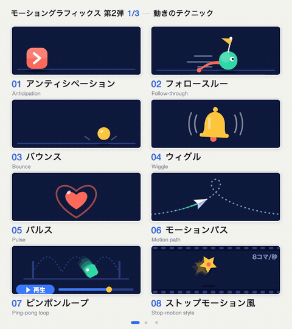

<!-- 這個檔案由 tools/build.mjs 根據 meta.json 產生。要修改請編輯 meta.json，不要改這個檔案。 -->

# 動態圖形動效（第二輯）

24 個名稱 · #121–144 · 包 `motion2` · 語言: [English](README.md) / [日本語](README.ja.md) / [中文](README.zh.md)

找到名稱後，直接告訴 AI。再加上「幾秒」「多強」「什麼在動」，結果會更接近你想要的。

## Motion techniques

| 編號 | 名稱 | 英文名稱 | 一句話說明 | 對 AI 的說法範例 |
|---|---|---|---|---|
| [#121](https://budingsm.github.io/motion-prompt-zh/#121) | **預備動作** | Anticipation | Pulls back briefly before moving forward | Add anticipation before the button shoots off to the right: pull back slightly for 0.3 s, squash, then go. |
| [#122](https://budingsm.github.io/motion-prompt-zh/#122) | **跟隨動作** | Follow-through | Parts keep swinging after the body stops | Give the hair and the flag follow-through after the character stops: they keep swinging for about 0.5 s, then settle. |
| [#123](https://budingsm.github.io/motion-prompt-zh/#123) | **彈跳** | Bounce | Falls and bounces lower until it stops | Drop the ball from the top with a bounce: three bounces, each lower than the last. |
| [#124](https://budingsm.github.io/motion-prompt-zh/#124) | **抖動** | Wiggle | Shakes in small, random, continuous jitters | Add a subtle wiggle to the notification bell, up to about 10°, for as long as it rings. |
| [#125](https://budingsm.github.io/motion-prompt-zh/#125) | **脈衝** | Pulse | Its size throbs like a heartbeat | Make the heart icon pulse: about 10% larger and back, every 1.2 s. |
| [#126](https://budingsm.github.io/motion-prompt-zh/#126) | **運動路徑** | Motion path | Moves along a curve that you define | Fly the paper plane along this curve as a motion path in 4 s, turning it to face the direction of travel. |
| [#127](https://budingsm.github.io/motion-prompt-zh/#127) | **往返循環** | Ping-pong loop | Plays forward, then backward, over and over | Move the loading dot back and forth as a ping-pong loop, 1 s each way. |
| [#128](https://budingsm.github.io/motion-prompt-zh/#128) | **定格動畫風格** | Stop-motion style | Moves in choppy steps, with frames dropped | Make this move stop-motion style: 8 frames per second, with a slight jitter on every frame. |

## Text & shapes

| 編號 | 名稱 | 英文名稱 | 一句話說明 | 對 AI 的說法範例 |
|---|---|---|---|---|
| [#129](https://budingsm.github.io/motion-prompt-zh/#129) | **文字亂碼切換** | Text scramble | Letters shuffle at random, then settle | Bring the headline in with a text scramble: random characters for about 1 s, settling from left to right. |
| [#130](https://budingsm.github.io/motion-prompt-zh/#130) | **波浪文字** | Wave text | Letters rise and fall in turn, like a wave | Animate the logo letters as wave text, each letter slightly behind the last, about 20 px up and down. |
| [#131](https://budingsm.github.io/motion-prompt-zh/#131) | **路徑文字** | Text on a path | Text flows along a line or curve | Run the tagline as text on a path along a wavy line, scrolling left to right, one full pass every 5 s. |
| [#132](https://budingsm.github.io/motion-prompt-zh/#132) | **可變字體動畫** | Variable font animation | The weight of the letters changes smoothly | Use a variable font animation on the title: from Thin to Black (weight 100 to 900) in 1 s. |
| [#133](https://budingsm.github.io/motion-prompt-zh/#133) | **文字蒙版** | Text mask | Letters cut out to show a picture inside | Use the word OCEAN as a text mask with ocean footage inside, and reveal the whole footage in the last second. |
| [#134](https://budingsm.github.io/motion-prompt-zh/#134) | **重複器** | Repeater | Duplicates a shape and turns the copies | Use a repeater to make 12 copies of this petal in a circle, turning once every 4 s. |
| [#135](https://budingsm.github.io/motion-prompt-zh/#135) | **萬花筒** | Kaleidoscope | Mirrored patterns spread out symmetrically | Put a kaleidoscope behind the logo: 8-way mirror symmetry, turning slowly as it spreads out. |
| [#136](https://budingsm.github.io/motion-prompt-zh/#136) | **線條抖動** | Line boil | Hand-drawn lines wobble frame to frame | Add line boil to the hand-drawn illustration: 10 frames per second, with the lines shifting only 2–3 px. |

## Transitions & highlights

| 編號 | 名稱 | 英文名稱 | 一句話說明 | 對 AI 的說法範例 |
|---|---|---|---|---|
| [#137](https://budingsm.github.io/motion-prompt-zh/#137) | **推入轉場** | Push transition | The next scene pushes the current one out | Go to the next slide with a push transition from the right, 0.8 s. |
| [#138](https://budingsm.github.io/motion-prompt-zh/#138) | **百葉窗轉場** | Blinds transition | The next scene opens through thin strips | Change scenes with a blinds transition: seven horizontal strips that open over 1 s. |
| [#139](https://budingsm.github.io/motion-prompt-zh/#139) | **立方體轉場** | Cube transition | Changes scenes like a turning cube | Switch the product shots with a cube transition, turning 90° to the left in 0.8 s. |
| [#140](https://budingsm.github.io/motion-prompt-zh/#140) | **頁面捲曲** | Page curl | Peels back like paper to show the next page | Go to the next chapter with a page curl from the bottom-right corner, 1.2 s. |
| [#141](https://budingsm.github.io/motion-prompt-zh/#141) | **像素化** | Pixelate | Turns into coarse blocks, then switches | Use a pixelate transition: the mosaic gets coarser over 0.6 s and the scene changes at the coarsest point. |
| [#142](https://budingsm.github.io/motion-prompt-zh/#142) | **碎裂** | Shatter | Breaks like glass and the shards fly off | Before the title appears, break the previous scene with a shatter: cracks first, then the shards fall away in about 1 s. |
| [#143](https://budingsm.github.io/motion-prompt-zh/#143) | **爆炸視圖** | Exploded view | Parts separate to show the structure inside | Show an exploded view of the product: four parts spread apart in 1 s, each with a name label. |
| [#144](https://budingsm.github.io/motion-prompt-zh/#144) | **分屏** | Split screen | Divides the frame to show scenes side by side | Show three scenes at once with a split screen: from one panel to two, then three, 0.5 s each. |

點編號會在圖庫打開會動的範例。單一名稱的秒數、緩動數值和參考程式碼： `api/v1/zh-Hant/e/<id>.txt` ([#121](../../api/v1/zh-Hant/e/121.txt)).

[所有包](../README.md)
